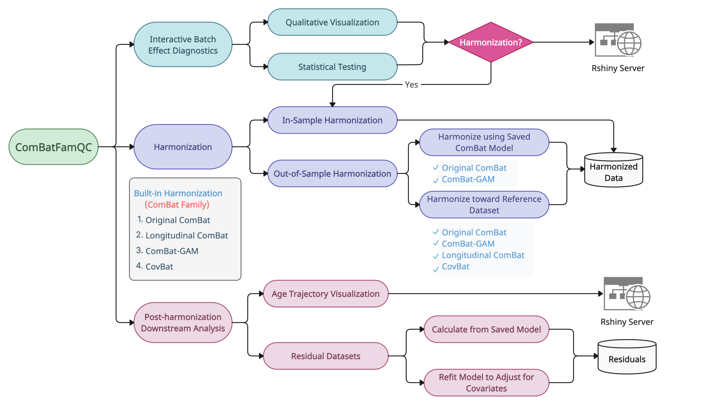

# ComBatFamQC

 <!-- badges: start -->
  [](https://github.com/Zheng206/ComBatFamQC/actions/workflows/R-CMD-check.yaml) [](https://app.codecov.io/gh/Zheng206/ComBatFamQC)
  <!-- badges: end --> 


The **ComBatFamQC** package is a powerful tool designed to streamline <span style="color:purple;">interactive batch effect diagnostics</span>, <span style="color:green;">harmonization</span>, and <span style="color:blue;">post-harmonization downstream analysis</span>. This package is specifically tailored to provide both <u>interactive qualitative visualization</u> and <u>statistical testing for batch effects diagnostics</u>, as well as to offer various easily-used <u>built-in harmonization techniques</u> to facilitate a better harmonization process.

Additionally, the package provides <u>life span age trends of brain structures</u> and <u>residual datasets</u>, eliminating specific covariates' effects to better conduct post-harmonization downstream analysis. For the final delivery, the package offers interactive visualizations through R Shiny for batch effect diagnostics and age trend visualization. For users who wish to save a copy of the diagnostic report, the package also includes an option to generate a Quarto report (if Quarto is installed). Furthermore, it integrates the harmonization process and can provide a harmonized dataset, a fitted ComBat model, a residual dataset, a fitted regression model, and more.

To make the harmonization process more accessible to users from diverse backgrounds, two unified command-line interfaces have been developed for different stages of the processing pipeline (located in the **inst** folder):

-   **CombatQC_CLI.R**: Batch Effect Diagnostics & Harmonization Stage
    -  Offers interactive diagnostics for batch effects
    -  Export the batch effect diagnosis report
    -  Performs data harmonization to adjust for batch effects  
-   **post_CLI.R**: Post-Harmonization Stage
    -   Visualizes age trends across brain structures over the lifespan
    -   Generates a residual dataset with unwanted covariate effects removed

Note: Detailed information and tutorials can be found: https://zheng206.github.io/ComBatQC-Web/

## Diagram


## Package Features

The ComBatFamQC package offers the following five key functionalities:

1. <u>**Interactive Batch Effect Diagnostics & Harmonization**</u>

-   **Batch Effect Diagnostics**: ComBatFamQC provides two types of batch effect diagnostics methods for both individual batch effects and global batch effects: 1) *Qualitative Visualization* and 2) *Statistical Testing*. It simplifies the process of performing statistical analyses to detect potential batch effects and provides all relevant statistical test results for batch effect visualization and evaluation.

-   **Harmonization**: ComBatFamQC provides built-in harmonization methods based on [ComBatFamily](https://github.com/andy1764/ComBatFamily), developed by **Dr. Andrew Chen**, and an optional external ComBatLS backend. The available methods include:
    -   Original ComBat (Johnson et al., 2007)
    -   Longitudinal ComBat (Beer et al., 2020)
    -   ComBat-GAM (Pomponio et al., 2020)
    -   CovBat (Chen et al., 2021)
    -   ComBatLS (Gardner et al., 2025; optional ComBatFamily dependency)

-   **Interactive Visualization through R Shiny**: The ComBatFamQC package comes with an interactive visualization tool built on R Shiny, providing an intuitive user interface to explore and evaluate batch effects, as well as conduct interactive harmonization if needed. The output is organized into multiple tabs, which includes:

    -   **Data Overview**: Complete data overview and exploratory analysis
    -   **Summary**: Sample Size and Covariate Distribution
    -   **Residual Plot**: Additive and Multiplicative Batch Effect
    -   **Diagnosis of Global Batch Effect**: PCA, T-SNE and MDMR
    -   **Diagnosis of Individual Batch Effect**:
        -   *Statistical Tests for Additive Batch Effect*: Kenward-Roger (liner mix model), ANOVA, Kruskal-Wallis
        -   *Statistical Tests for Multiplicative Batch Effect*: Fligner-Killeen, Levene's Test, Bartlett's Test
    -   **Harmonization** Interactive Harmonization if needed

2. <u>**Post-Harmonization Downstream Analysis**</u>

-   **Age Trajectory** \
    Generate age trend of each brain structure (ROI), adjusting sex and ICV. Customized centiles are enabled as well.
    -  **Age Trend Plots**
    -  **Age Trend Table** 

-   **Residual Generation** \
    Generate residual data set, removing specific covariates' effetcs.


## Installation

### CRAN 

```{r}
install.packages("ComBatFamQC")
```

### GitHub

The GitHub build is one release ahead of CRAN and includes out-of-sample harmonization for CovBat.

```{r}
if (!require("devtools", quietly = TRUE)) {
    install.packages("devtools")   
}

library(devtools)

devtools::install_github("Zheng206/ComBatFamQC", build_vignettes = TRUE)
```

### Optional ComBatLS and dependency checks

ComBatLS uses the external [ComBatFamily](https://github.com/andy1764/ComBatFamily)
package (>= 0.2.2), installed only when needed. Existing ComBat and CovBat
methods work without it.

```r
library(ComBatFamQC)
check_dependencies()                 # Report missing packages and version problems
check_dependencies(install = TRUE)   # Install or update packages that need attention
check_dependencies(include_suggests = TRUE)  # Also check all optional packages
```

The helper checks declared version requirements and whether packages can load,
including dependencies of installed packages. It uses CRAN for ordinary packages
and GitHub for ComBatFamily, and rechecks after installation. Restart R if the
report shows `restart_required` after updating a loaded package.

Use explicit GAMLSS formulas with the existing dataset arguments and result structure:

```r
harm_ls <- combat_harm(
  df = adni, features = colnames(adni)[43:46], batch = "manufac",
  covariates = c("AGE", "SEX", "DIAGNOSIS"), family = "combatls",
  formula = y ~ AGE + SEX + DIAGNOSIS
)
harm_ls$harmonized_df
```

ComBatLS requires an explicit location `formula` and defaults to constant
biological scale (`sigma.formula = ~ 1`). Specify `sigma.formula` explicitly
to preserve biological scale effects:

| Intention | `formula` | `sigma.formula` |
| --- | --- | --- |
| Linear effects | `y ~ AGE_z + SEX` | `~ 1` |
| Preserve biological scale effects | `y ~ AGE_z + SEX` | `~ AGE_z + SEX` |
| Nonlinear biological effects | `y ~ pb(AGE_z) + SEX` | `~ pb(AGE_z) + SEX` |

```r
nonlinear_ls <- combat_harm(
  df = adni, features = colnames(adni)[43:46], batch = "manufac",
  covariates = c("AGE", "SEX"), family = "combatls",
  formula = y ~ pb(AGE) + SEX,
  sigma.formula = ~ pb(AGE) + SEX
)
```

Include every variable used by either formula in `covariates`; use `y` as the
mean response. GAMLSS helpers such as `pb()` resolve without attaching GAMLSS,
and custom functions in the formula's environment are preserved. Keep
`type = "lm"` for this API; ComBatLS always fits GAMLSS models. There is no
smoother conversion or automatic inheritance from the mean to the scale formula.
The legacy `smooth`, `interaction`, `random`, and `smooth_int_type` arguments
and mgcv smoothers such as `s()` are rejected for ComBatLS. Specify interactions
directly in the formulas, for example `y ~ AGE * SEX`. Use `formula = y ~ 1`
for an intercept-only location model. Other families retain automatic formula
generation for ComBat, ComBat-GAM, longitudinal ComBat, and CovBat.
`ref.batch` and reference-data harmonization use the existing arguments.
Mixed effects, saved-model prediction, and the EB assumption diagnostic are
currently unavailable for ComBatLS.
Extra fitting options, such as `control = gamlss::gamlss.control(trace = FALSE)`,
pass through to ComBatFamily. The CLI accepts `--family combatls` as well.

### ComBatLS in Shiny

When ComBatFamily (>= 0.2.2) can load, the interactive **Harmonization** tab
includes `combatls` in the family selector. Enter a required location formula
(for example, `y ~ pb(AGE) + SEX`) and optionally change the scale formula from
`~ 1`. Available covariates are listed beside the formula inputs. Robust location
and scale estimation is optional; the existing EB and reference-batch controls
also apply. Data and fitted models use the existing save controls.

Selecting ComBatLS replaces the EB Check area with **Scale Model Check**:

1. Specify the location and proposed scale formulas.
2. Select candidate biological scale covariates and click **Run Model Check**.
3. Review **Covariate screening**, **Centile curves**, and the fitting-status message.
4. Review or edit the proposed scale formula, rerun the check if it changed, then
   harmonize and save through the existing controls.

The screening model always includes the selected candidates in scale, even when
the proposed scale formula is `~ 1`. By default candidates enter linearly; an
optional exploratory formula such as `~ pb(AGE) + SEX` screens smooth effects.
Batch terms enter both location and scale. Each candidate is tested by jointly
removing all its scale terms, including interactions and entire smooth terms,
while leaving location unchanged. The heatmap shows BH-adjusted p-values
(Benjamini-Hochberg adjustment) across features **separately for each candidate**.
The internal `q.value` field holds these adjusted p-values; it is not a Storey
q-value. The Shiny interface labels it **BH-adjusted p-value**. Failed comparisons
remain in the correction family and are shown as unavailable. Smooth-model LRTs
use effective degrees of freedom and are **approximate**; inspect fit warnings.

Liberal screening drafts are optional: **Use suggested scale formula**
copies a draft into the editable field only after you request it. The draft includes
any candidate with at least one feature with a BH-adjusted p-value < 0.05, retaining interaction
marginal terms. It is **not an optimal model**: a covariate significant for 1 of
62 features still enters this liberal draft. Review scientific relevance and
sensitivity analyses rather than accepting it solely on significance. Significance
never changes your formula automatically. Prespecified biology can justify
retaining effects with nonsignificant screening results; repeated testing and
model selection can overfit.

The R screening summary includes significant-feature percentages relative to all
features and to valid tests (failed comparisons are excluded only from the latter
denominator). `effects` reports screening-model conditional SD ratios: `exp(eta)`
for a one-unit increase in an additive linear covariate, and group-specific ratios
versus the first factor level for additive categorical effects. For example,
`eta = 0.2` means about a 22% SD increase per original unit. These are associations,
not causal effects. `effect_summary` gives median and quartiles across **all
estimable features**, including nonsignificant ones. Smooth, transformed, or
interaction effects have no single constant ratio and are marked unavailable;
inspect their centile curves instead.

In Shiny, screening displays a 650-pixel heatmap without crowded feature or tile
labels, a **Biological Scale Summary**, and a collapsible **Feature-wise results**
table. The summary shows significant features as a count over all features, their
percentage, valid-test counts, and the median SD ratio when a single contrast is
meaningful. Multiple categorical contrasts remain in the detailed table. Joint
test p-values are repeated for those contrasts, not calculated separately.
The feature-wise table highlights significant rows and sorts on the full numeric
BH-adjusted p-value, with unavailable tests last. A covariate selector and a
significant-only checkbox filter the view without recalculating the adjustment.
A separate `sig` column marks BH-adjusted p-values with `*` below 0.05,
`**` below 0.01, and `***` below 0.001. Significant p-values appear in red and
their rows in light yellow. Contrast labels, SD ratios and SD
changes remain visible; unadjusted p-values are hidden by default. Test statistics,
degrees of freedom, methods and diagnostic statuses remain in the R results.
Decimals use three places, and p-values below 0.001 display as `<0.001`; the saved
R results retain full numeric precision. Evidence categories reflect statistical
thresholds, not scientific importance, and nonsignificance does not establish
absence of a biological effect.

Shiny shows two model-check tabs: **Covariate Screening** and **Centile Curves**.
Feature and model controls live in Centile Curves; the model selector appears only
when viewing a single model. A compact fitting-status message reports convergence,
identifiability, and fits with warnings or errors. Fitting status does not establish
model adequacy. Residual diagnostics and full convergence details remain available
in R through `combatls_check_plot(check, "qq")`,
`combatls_check_plot(check, "residuals", x = "AGE")`, and `check$diagnostics`.

The proposed and exploratory fits, normalized quantile residuals, convergence
status, and fitted distribution parameters are cached. Plot changes do not run
GAMLSS fitting again. Editing either formula, the candidates, or the reference
batch marks the check stale until you explicitly rerun it. Model checking never
produces harmonized observations. The fits assume independent observations.

Centile curves overlay solid medians with darker 25th-75th and lighter 5th-95th
centile bands, colored by proposed or screening model. Both models use an identical
covariate grid, holding other covariates at medians or modal levels. These bands
show fitted distributional spread, **not confidence intervals**. Ungrouped plots
have no facet header. AGE is the default horizontal covariate when available;
feature choices are ordered by adjusted p-value for that covariate, preserving
the selected feature. This ordering reflects statistical evidence, not effect size.

An SD comparison beneath the plot evaluates both fitted models at the observed
25th and 75th percentiles of the horizontal covariate, separately within each
selected group. It reports original covariate values, fitted SDs, and
`100 * (SD_upper / SD_lower - 1)`. Exact quantile predictions use the cached fits;
no model fitting is repeated. R users can obtain the corresponding distribution
parameters with `combatls_check_centiles(..., x.quantiles = c(.25, .75),
probabilities = .5, model = "both")`.

Raw observations can be added using **Show observed measurements** (off by
default), or `show.points = TRUE` in `combatls_check_plot()`. They retain their own
biological covariates and batch effects. The gray overlay describes observed
spread and does not test calibration against the plotted reference profile.

Location and log-scale batch effects are pooled using observed batch proportions or the selected reference batch.
These are conditional, model-implied exploratory targets, **not empirical
population centiles or EB-adjusted harmonization outputs**. Q-Q plots and
residual-versus-covariate plots assess in-sample goodness of fit through the R API.
The concise note beneath the plot explains that curves show a batch-targeted
biological profile, bands are centiles rather than confidence intervals, and these
exploratory results do not establish model adequacy. The optional raw-points note
explains their different biological and batch profiles. Residual checks remain
available in R, particularly for interpreting the tails.

The fitting and plotting stages are also available in R:

```r
check <- combatls_model_check(
  df = adni, features = colnames(adni)[43:46], batch = "manufac",
  covariates = c("AGE", "SEX"), formula = y ~ AGE + SEX,
  sigma.formula = ~ 1, candidates = c("AGE", "SEX")
)
check$screening
check$summary
check$effect_summary
check$effects
check$diagnostics
combatls_check_plot(check, "screening")
combatls_check_plot(check, "qq", feature = check$features[1])
combatls_check_plot(check, "centiles", feature = check$features[1], x = "AGE", group = "SEX", model = "both")
```

The legacy model, smooth, random, interaction, and EB assumption diagnostic
controls remain available for ComBat/CovBat. If ComBatFamily cannot load, the
original interface is shown. Formula errors produce notifications without saving
a new harmonization result.

Statistical references: [GAMLSS model comparisons and prediction](https://gamlss-dev.r-universe.dev/gamlss/doc/manual.html),
[ComBatLS](https://doi.org/10.1002/hbm.70197).

### ComBatLS from the command line

The CLI requires `argparser`, `readr`, `readxl`, and `stringr`, plus the optional
ComBatFamily backend for ComBatLS. Formula strings use column **names**, while
`--batch`, `--features`, and `--covariates` use column **positions**. Include all
variables from both formulas in `--covariates`. The CLI reports any missing
formula variables before reference loading or fitting. This check does not
validate function availability; GAMLSS resolves functions separately.

For a CSV with batch in column 1, `AGE_z` and `SEX` in columns 2–3, and features
in columns 4–8:

```bash
combatqc_cli="$(Rscript -e 'cat(system.file("combatQC_CLI.R", package="ComBatFamQC"))')"
Rscript "$combatqc_cli" data.csv \
  --diagnosis FALSE --family combatls \
  --batch 1 --features 4-8 --covariates 2-3 \
  --formula 'y ~ pb(AGE_z) + SEX' \
  --sigma.formula '~ pb(AGE_z) + SEX' \
  --eb TRUE --outdir harmonized.csv --mout combatls.rds
```

`--formula` is required for ComBatLS, including for linear effects or an
intercept-only model (`y ~ 1`). Omitting `--sigma.formula` uses constant scale
(`~ 1`). The legacy `--smooth`, `--interaction`, and `--random` options are not
supported for ComBatLS; put GAMLSS effects and interactions in the formulas.
The formula options apply to ComBatLS harmonization. `--family combatls` selects
GAMLSS automatically; `--model` is ignored as a fitting-engine selector for this
family. Specify nonlinear effects directly in the formulas. The API reports installation instructions if
ComBatFamily is missing or too old. The CLI does not install packages automatically.

## Tutorial

```{r}
vignette("ComBatQC")
vignette("Post-Harmonization")
```

## Command-line Interface

```{bash}
RSCRIPT=${RSCRIPT:-$(command -v Rscript)}
combatqc_cli="$($RSCRIPT -e 'cat(system.file("combatQC_CLI.R", package="ComBatFamQC"))')"
post_cli="$($RSCRIPT -e 'cat(system.file("post_CLI.R", package="ComBatFamQC"))')"

Rscript $combatqc_cli -h
Rscript $post_cli -h
```


